# Pelit

Jokainen kansio on yksi peli (`game.json`, `game.tsx`, `style.css`). Moottori listaa ne valikkoon, ja valikkoa voi vierittää sormella. Jokaisen pelin oikeassa yläkulmassa on ✕, josta pääsee takaisin valikkoon.

Kuvat on otettu web-versiosta (360 × 720) komennolla `node tools/shot.js`, ja ne ovat kansiossa [`docs/screenshots`](../docs/screenshots).

| | Peli | Kansio | Mitä siinä tehdään |
|---|---|---|---|
| 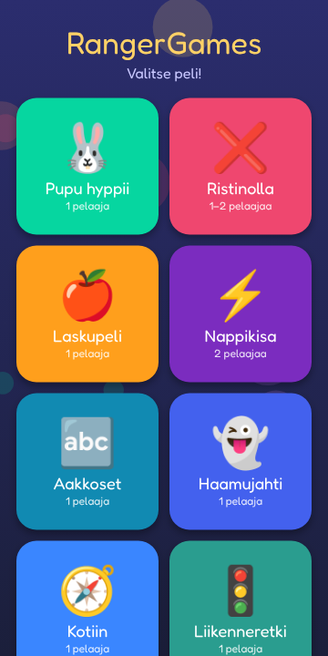 | **Valikko** | `launcher` | Kaikki pelit ruutuina. Napauta peliä, ja se käynnistyy. |
| 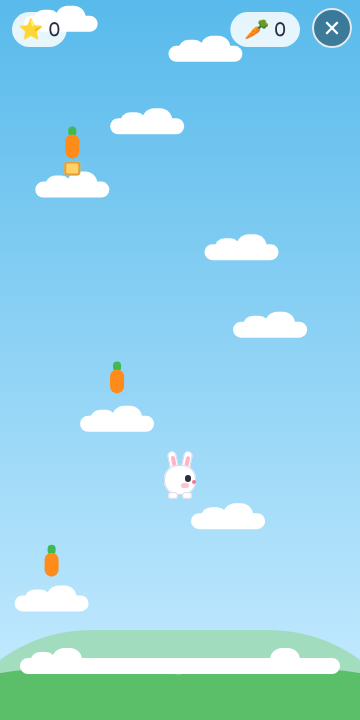 | **Pupu hyppii** | `pupu` | Pupu hyppii pilveltä toiselle ja kerää porkkanoita. Ohjataan pitämällä sormea vasemmalla tai oikealla puolella. |
| 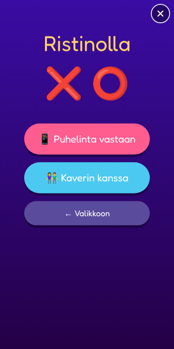 | **Ristinolla** | `ristinolla` | Ristinollaa puhelinta tai kaveria vastaan. |
| 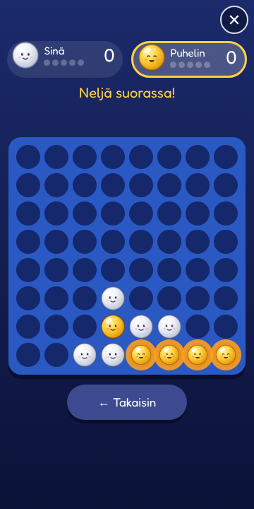 | **Pallosade** | `pallosade` | Kaksinpeli tai puhelinta vastaan: valkoisia ja keltaisia palloja pudotetaan 8 × 8 ruudukkoon. Neljä samaa suoraan (vaakaan, pystyyn tai vinoon) välkkyy ja häviää, omistaja saa pisteen (+1 jokaisesta pallosta yli neljän), ja yläpuolen pallot putoavat alas, mistä voi syntyä combo. Ensin 5 pistettä voittaa. Pallot piirretty itse (`tools/pallosade/balls.js`), säännöt `lib/rules.ts`, testi `tests/pallosade.ts`. |
| 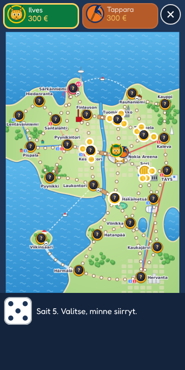 | **Kanada-malja** | `kanadamalja` | Ilves vastaan Tappara, kaksin tai puhelinta vastaan: etsi Kanada-malja Tampereelta ja vie se ensimmäisenä Nokia Areenalle. Noppa, napit (Kummola, timantti, Raipe, Barkov, mustamakkara, rosvo, poliisi), Sorin putka, Särkänniemessä kaikki tuplana, ratikat 1 ja 3 sekä laivat maksavat 50–150 €, ja maljan kantajan voi taklata. Lauta ja kuvat piirretty itse (`tools/kanadamalja/build.py`), vain julkisia paikkoja. |
| 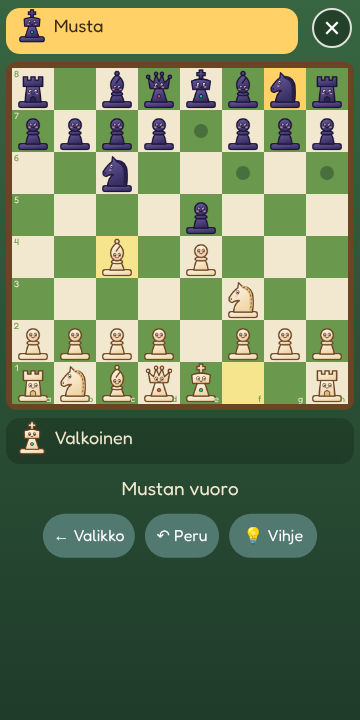 | **Shakki** | `shakki` | Shakkia kahdestaan tai puhelinta vastaan (helppo, keskitaso, vaikea). Kaikki säännöt: linnoitus, ohestalyönti, korotus, shakki, matti, patti ja tasapelit. Napautettu nappula näyttää siirtonsa ja sanoo nimensä, 💡 antaa vihjeen ja ↶ perii siirron. Kesken jäänyt peli jatkuu. Nappulat piirretty itse (`tools/shakki/pieces.js`). |
| 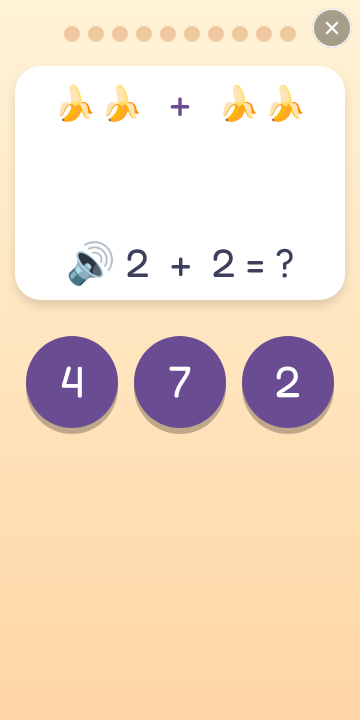 | **Laskupeli** | `laskupeli` | Lasketaan hedelmiä: plussaa ja miinusta, tehtävät luetaan ääneen. |
| 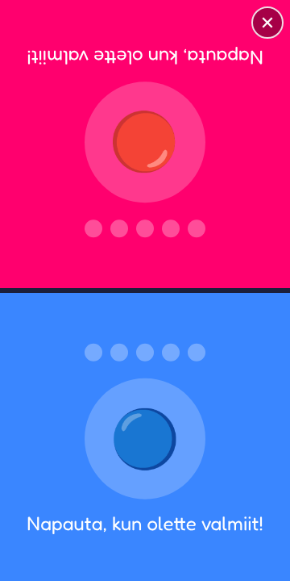 | **Nappikisa** | `nappikisa` | Kaksinpeli: puhelin on pelaajien välissä, ja se voittaa, joka napauttaa ensin, kun valo vaihtuu. |
| 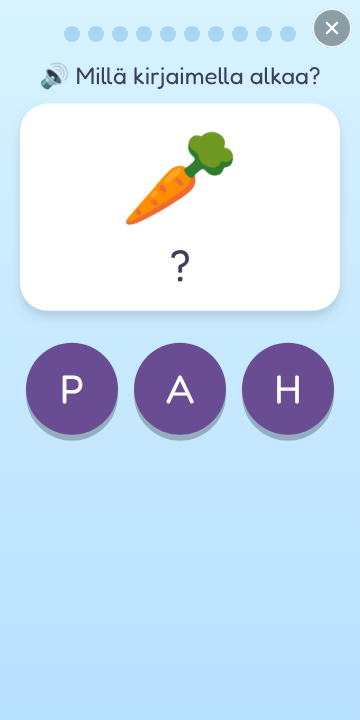 | **Aakkoset** | `aakkoset` | Eskari: alkukirjaimet ja kirjainten etsintä. 2. luokka: tavut ja oikea kirjoitusasu. |
| 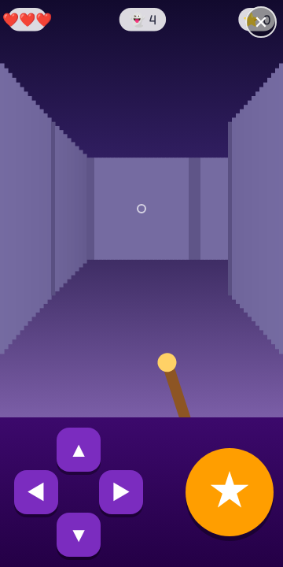 | **Haamujahti** | `haamujahti` | 3D-linna ensimmäisestä persoonasta: pahikset (haamut, luurangot, peikot, noita, susi, lohikäärme) muuttuvat tähdiksi, kilttejä eläimiä ja tonttuja ei ammuta, ja ovet aukeavat laskutehtävillä. |
| 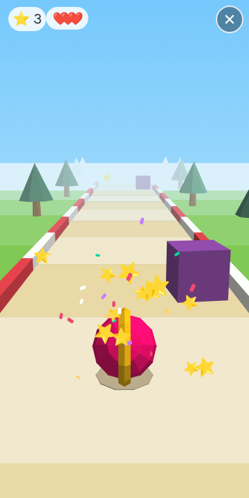 | **Pallopolku** | `pallopolku` | 3D-juoksupeli moottorin omalla 3D-kerroksella (`rg.three`): vaihda kaistaa, hyppää laatikoiden yli ja kerää tähtiä. |
| 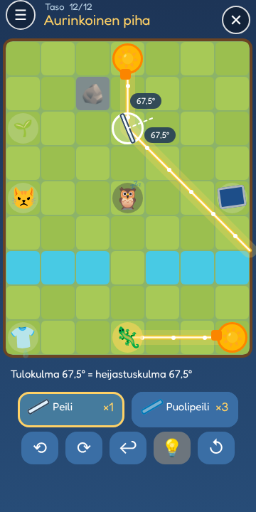 | **Valopeilit** | `peilit` | Valo-opin peli: aurinko tai taskulamppu loistaa, ja peileillä valo ohjataan kukalle, aurinkopaneelille, päiväunia haluavalle kissalle, kylmälle liskolle tai märälle pyykille, mutta ei päivällä nukkuvalle pöllölle. Napautettu peili kääntyy 22,5°, ja valitun peilin kohdalla näkyy, että tulokulma = heijastuskulma. Puolipeili jakaa valon kahtia, lukittuja peilejä ei voi kääntää, ja lammen yli valo kulkee. 12 tasoa; tähdet sen mukaan, montako peiliä käytti (vähin määrä tarkistetaan `tools/peilit/solve.ts`:llä). |
| 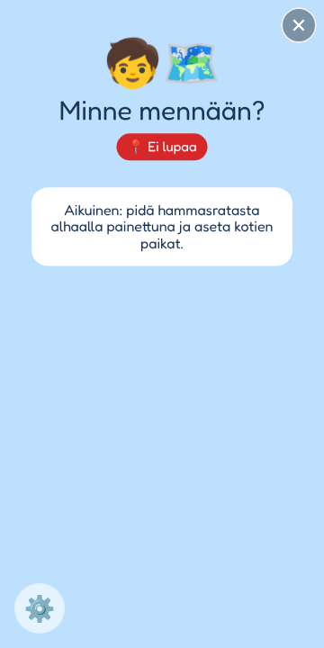 | **Kotiin** | `navi` | Lapsen kävelynavigaattori: GPS, iso nuoli ja reittiviiva kotiin, kouluun tai päiväkotiin. Toimii ilman nettiä. |
| 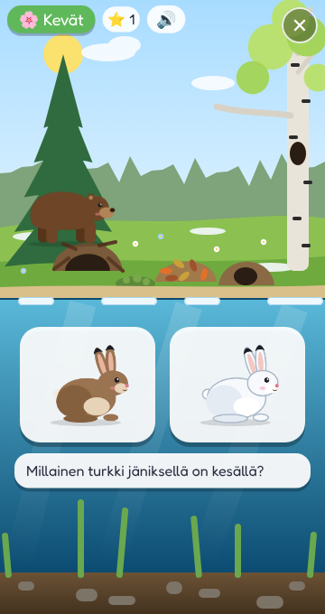 | **Vuodenajat** | `vuodenajat` | Eläinten vuosi: herätä karhu, valitse jäniksen, kärpän ja riekon turkki vuodenajan mukaan, mitkä linnut lentävät etelään, auta oravaa ja närheä varastoimaan ruokaa, vie eläimet talvipesiin ja onki kesällä veneestä ja talvella pilkillä jään alta. Katsele-tilassa vuodenaikaa vaihdetaan ja eläimiä napautetaan. Kaikki ohjeet puhutaan. |
| 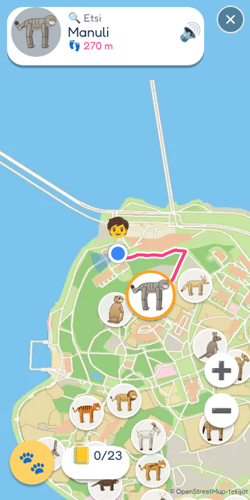 | **Korkeasaari** | `korkeasaari` | Suunnistus Korkeasaaren eläintarhassa: etsi eläin kartalta, kävele sen luo sormella tai oikeasti GPS:n kanssa (toimii ilman nettiä), ja vastaa ääneen luettuihin kuvakysymyksiin. Jokaisesta eläimestä saa tarran. 🐣 Eskari / 🎒 Koulu. Kartta ja eläinten paikat © OpenStreetMap-tekijät (ODbL), ks. `tools/korkeasaari`. |
| 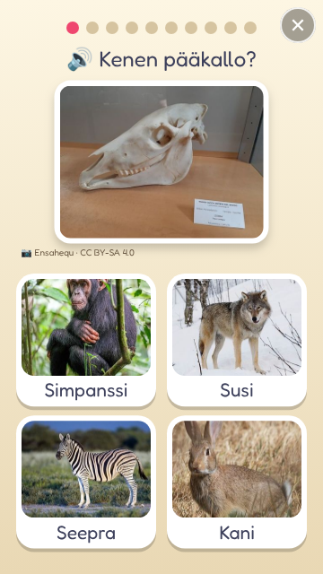 | **Kenen luut?** | `luut` | Oikea valokuva eläimen pääkallosta tai luurangosta, ja neljästä eläimestä valitaan oikea. Kuvat Wikimedia Commonsista (CC/PD), tekijät `games/luut/CREDITS.md`. |
| 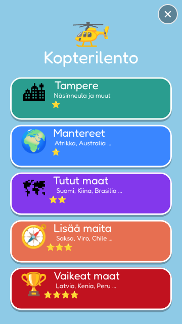 | **Kopterilento** | `kopteri` | Maantietoa helikopterilla: Tampereen paikat ylhäältä ja maapallolla mantereet ja maat. |
| 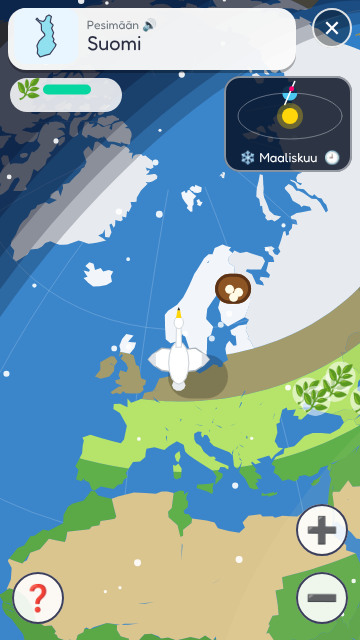 | **Muuttolintu** | `muutto` | Lennä muuttolintuna Suomeen pesimään ja takaisin. Vuodenajat ja aurinko näkyvät maapallolla. |
| 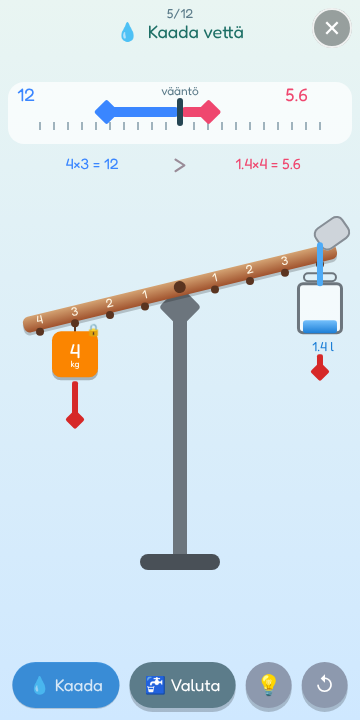 | **Vipuvaaka** | `vipu` | Tiedepeli vipuvarresta: tasapainota vaaka lisäämällä punnuksia, siirtämällä niitä toiseen koukkuun tai kaatamalla vettä ämpäriin (litra = kilo). Nuolet näyttävät kummankin puolen väännön (paino × etäisyys) ja summat kirjoitetaan auki (2×3 = 6). 12 tasoa ja vapaa leikki, 💡 antaa vihjeen. |
| 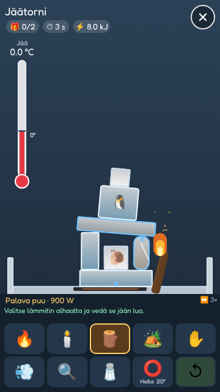 | **Lämpölabra** | `lampolabra` | Jääpalikoita ja jäätyneitä aarteita laboratorion altaassa. Lämmitä tulitikulla, kynttilällä, palavalla puulla, retkikeittimellä, hellanlevyllä, kämmenellä (joka jäätyy, jos sitä pitää liian kauan), hiustenkuivaajalla tai suurennuslasilla ja auringolla, tai sirottele suolaa. Jää lämpenee ensin 0 °C:seen ja sulaa sitten; sulava jää halkeaa paloiksi, ja oma fysiikkamoottori (`lib/physics.ts`) kaataa tornit. Sulamisvesi kerääntyy altaaseen, jää kelluu, kuivajää muuttuu suoraan kaasuksi ja hella keittää veden höyryksi. Lämpömäärät ovat oikeita (2,1 J/g·K, 334 J/g), vain aika kulkee 3× nopeammin. |
| 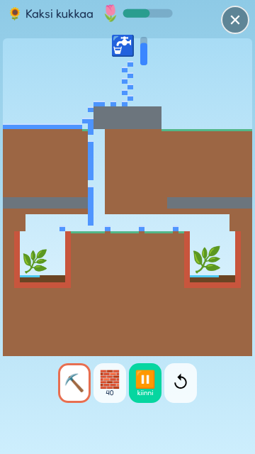 | **Vesiputket** | `vesiputket` | Vesi- ja hiekkasimulaatio 8 px:n ruudukossa: hiekka ja vesi putoavat ja valuvat rinteitä alas, vesi leviää sivuille ja hakee tasonsa, hiekka uppoaa veden läpi, vesi sammuttaa tulen ja viemäri nielee veden. Kaiva maata ⛏️, rakenna putkia 🧱 ja kaada hiekkaa 🏖️, niin vesi tai hiekka menee perille: kastele kukat, sammuta luolan nuotio, täytä ankan allas ja hiekkalaatikko. Säiliössä on rajallisesti vettä. Kuusi tasoa ja vapaa leikki (myös tuli). |
| 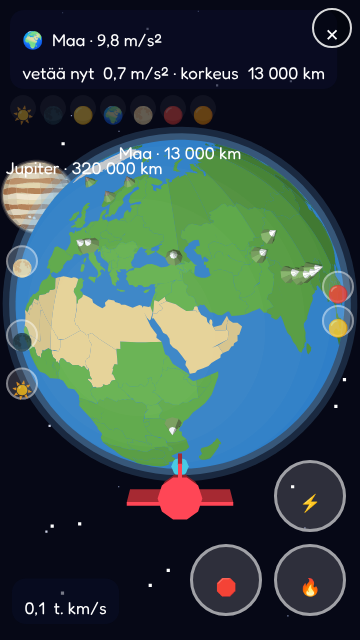 | **Painovoimalento** | `painovoima` | Lennä raketilla planeettojen ja Kuun luo. Lähellä taivaankappale vetää sinua puoleensa (Kuussa hitaasti, Jupiterissa lujaa), ja pinnalta pomppaat kuin kumipallo. Käy jokaisella! |
| 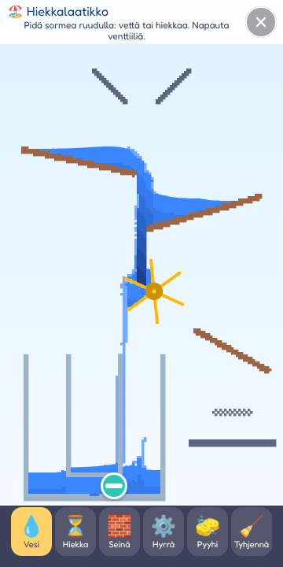 | **Vesilabra** | `vesilabra` | Vettä ja hiekkaa putkistoon: hiekkalaatikossa kaadetaan sormella vettä tai hiekkaa ja lisätään seiniä ja hyrriä. Kentissä avataan venttiili, käännetään putket, annetaan hyrrän nostaa portti, täytetään kaksi yhteydessä olevaa astiaa viivoihin ja tukitaan kuoppa hiekalla. Opitaan veden virtaus, painovoima ja yhteydessä olevat astiat. |
| 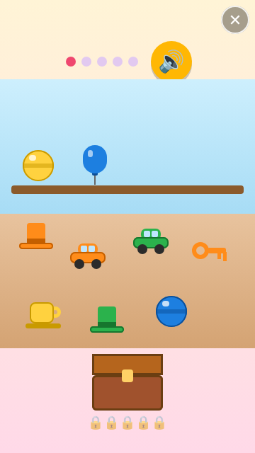 | **Kielipelit** | `kielipelit` | Englantia ja espanjaa: sanat, "Find the red key", kahvila ja tarina. Ohjeet puhutaan. |
| 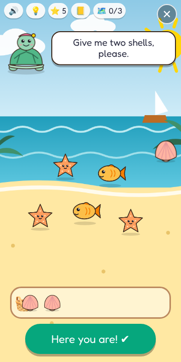 | **Kielisaari** | `kielisaari` | Englantia tai espanjaa (lippu valitaan alussa) seikkaillen: auta kilpikonnaa, apinaa ja karhun kahvilaa, kerää kolme karttapalaa ja avaa luolan aarrearkku. Jokainen sana kulkee polun kuule → tunnista → muista (kokoa kirjaimista ja sano ääneen) → käytä ("Give me two red apples") → kertaa; uusi päivä alkaa kertauksella (Leitner-laatikot). Väärästä vastauksesta tulee vihje, ei rangaistusta. 💡 näyttää lauseen suomeksi. |
| 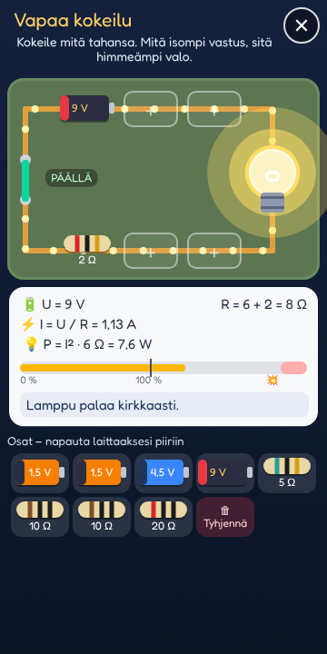 | **Lamppulabra** | `lamppu` | Sähköoppia: paristo, yksi vastus ja lamppu. Valitse paristo ja vastus (oikeat värikoodit); mitä pienempi vastus, sitä kirkkaampi valo, ja rajalla lamppu poksahtaa mustaksi. |
| 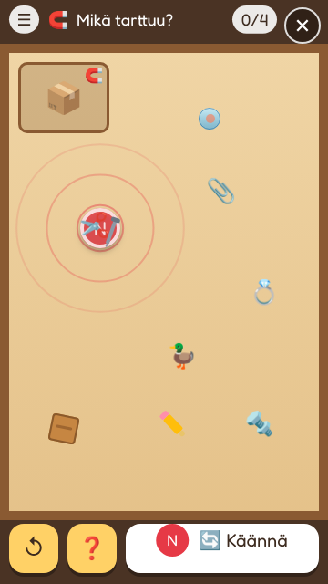 | **Magneettipaja** | `magneetti` | Fysiikkapeli magneeteilla: magneetti (punainen tai sininen napa, 🔄 kääntää) vetää rautaa ja terästä, työntää ja vetää toisia magneetteja ja kuljettaa teräskuulan sokkelon läpi laudan alta. Kuusi tehtävää: naulat laatikkoon, mikä tarttuu (puu, muovi, lasi ja kulta eivät), kuula sokkelossa, hylkiminen, sauvamagneetin kaksi napaa ja esteet, joissa kiinnitetyt magneetit vetävät kuulaa. Oma pieni fysiikkamoottori (`games/magneetti/lib/fysiikka.ts`): jäykät kappaleet, törmäykset, kitka ja napojen voimat. |

Seuraavat pelit tehtiin puhelinta varten Macilla, ja ne tulevat tähän listaan, kun ne on viety GitHubiin: Kirjainpallot, Onkipeli, Avaruusretki, Sanaseikkailu ja Kolmården.

Kotien tarkat paikat ovat vain git-ignoroiduissa `places.local.js`-tiedostoissa, ja Kolmårdenin perhekuvat (`perhe/`) eivät koskaan mene repoon.
